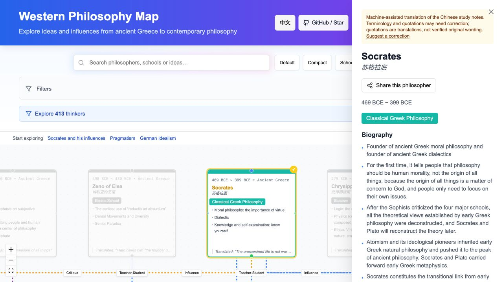

# Western Philosophy Map · An Interactive History of Ideas

[中文](README.md) · **English**

[](LICENSE)

**Original project code is licensed under [AGPL-3.0-only](LICENSE), version 3 only.** If you modify the software and provide it over a network, comply with the license's corresponding-source requirements for those users.

An open-source learning companion for exploring philosophers, philosophical schools and intellectual influences from ancient Greece to contemporary thought.

**Public snapshot: 413 philosophers · 115 schools · 131 relationships · 5 layouts · No database required**

**[Open the English map](https://western-philosophy.inklinks.io/en/)** · [中文网站](https://western-philosophy.inklinks.io/)

The standalone site follows this repository's releases; report corrections and suggestions through [GitHub Issues](https://github.com/adonisly/western-philosophy-map/issues). English content is machine-assisted translation of the Chinese study notes, with curated school names and selected terminology corrections. It remains open to editorial review; translated quotations are not verified original-language quotations.

An interactive **Western philosophy map**, **history of philosophy timeline** and **philosopher influence graph**. Search thinkers, schools and ideas; explore connections without a database, account or API key.

[](https://western-philosophy.inklinks.io/en/)

## Operation demo

[Watch the 52-second walkthrough (MP4, approximately 2.6 MB, Chinese captions)](assets/demo.mp4) · [Recording notes and storyboard (Chinese)](docs/DEMO.md)

<details>
<summary>View the 17-second animated preview (Chinese interface and captions)</summary>


</details>

These recordings show the original Chinese interface. The [live English site](https://western-philosophy.inklinks.io/en/) provides the same graph layouts, search and exploration controls.

## Get started in 30 seconds

1. Search for “Socrates”, “苏格拉底” or “sgld”, then select a suggestion to locate the philosopher.
2. Open a card to read the biography, main ideas, works, intellectual sources and later influence.
3. Switch between Influences, Centuries and Schools to explore different perspectives. Use 中文 / English in the header to switch language while retaining the current selection and filters.

If this helps your reading, star the project using **GitHub / Star** in the header. Include reliable sources when [suggesting a correction](https://github.com/adonisly/western-philosophy-map/issues).

## Share and explore

- **Share** creates a link to the current language, layout, search and filters. **Share this philosopher** opens the selected person's details. Drag positions and zoom are not included.
- Start with Socrates and his influences, Pragmatism or German Idealism.
- The [English philosophers and schools index](https://western-philosophy.inklinks.io/en/explore/) works without JavaScript and links back to the interactive map.
- Examples: [Socrates](https://western-philosophy.inklinks.io/en/?layout=lineage&philosopher=socrates_1760717560724), [Pragmatism](https://western-philosophy.inklinks.io/en/?layout=school&school=%E5%AE%9E%E7%94%A8%E4%B8%BB%E4%B9%89). Chinese school values in URLs are stable graph keys shared by both languages.

## Online editions and further reading

**[Western philosophy on ReadMap (Chinese)](https://readmap.inklinks.io/knowledge-graphs/western-philosophy)**

This project originated in [ReadMap](https://readmap.inklinks.io/), a Chinese-language platform connecting reading routes, knowledge maps and reading resources. Its philosophy page uses the shared graph core, with separately maintained data and host feedback features.

- [Reading routes](https://readmap.inklinks.io/reading-paths): structured learning paths by subject.
- [More knowledge maps](https://readmap.inklinks.io/knowledge-graphs): [Western music](https://readmap.inklinks.io/knowledge-graphs/western-music), [Buddhist history](https://readmap.inklinks.io/knowledge-graphs/buddhism-history), [Homeric epic](https://readmap.inklinks.io/knowledge-graphs/homeric-epic) and [Chinese dynasties](https://readmap.inklinks.io/knowledge-graphs/chinese-dynasties).
- [Reading community](https://bookclub.inklinks.io/): an external companion community.
- [Resource search](https://readmap.inklinks.io/pan-search) and [course resources](https://readmap.inklinks.io/resources): these two ReadMap sections require an access passcode.

These external destinations are primarily Chinese. The independent English edition is available at `/en/`; data update schedules and feedback channels differ between editions.

## Explore Western philosophy through an idea map

- Trace inheritance, development and criticism through thinkers, schools and directed relationships.
- Find intellectual sources and later influences for Socrates, Plato, Aristotle, Kant, Hegel and other thinkers.
- Filter by school, period and level; choose Default, Compact, Schools, Centuries or Influences.
- View chronological distributions using the Centuries layout.
- Use summaries and works as starting points for further reading; search in English, Chinese, pinyin or initials.

## Coverage: philosophers, schools and intellectual influences

The snapshot includes Western philosophy and related intellectual history. Examples include:

- **Ancient Greece:** Socrates, Plato, Aristotle, Stoicism, Epicureanism and Scepticism.
- **Medieval philosophy:** Augustine, Thomas Aquinas, patristic philosophy and Scholasticism.
- **Modern philosophy:** Descartes, Spinoza, Locke, Hume, Kant, Hegel, Marx and Nietzsche; rationalism, empiricism and German idealism.
- **Modern and contemporary traditions:** Husserl, Heidegger, Russell, Wittgenstein, Sartre and Foucault; phenomenology, existentialism, analytic philosophy and post-structuralism.

This is an evolving study map, not a complete or definitive taxonomy of philosophy.

## Learning and use

### How can I follow the history of philosophy?

Begin with a period or school, use Centuries for chronology, then Influences and relationship highlights to explore intellectual connections. Open details for summaries and suggested works.

### Can I use it as a philosophy mind map?

Yes, as a reading companion, revision aid or starting point for notes. Check substantive claims against primary works and reliable scholarship. English text is a translation of the existing notes and does not constitute a new scholarly review.

### Do I need a database or an account?

No. Online browsing, local development and static deployment use bundled JSON. The application uses React, TypeScript and React Flow. Translation happens before publication; visitors do not call a translation service.

## Run locally

Use Node.js 22.12 or newer.

```bash
npm ci
npm run dev
```

Open `http://127.0.0.1:3100/` for Chinese or `http://127.0.0.1:3100/en/` for English.

```bash
npm test
npm run check:translations
npm run build
npm run preview
```

Deploy `dist/` to a static host. Both `/index.html` and `/en/index.html` are real generated entry points; `/en/` does not depend on a host-specific SPA rewrite. Relative assets support deployment under a directory.

## Features and data

- English / Chinese UI, cards, details, filters, share dialogs and static indexes.
- Bilingual search, pinyin and initials; five layouts, directed edges, ancestor / successor highlights, zoom and minimap.
- Search history stays in the current browser's local storage.

`public/data/philosophy.json` is the shared structural snapshot. `snapshot-info.json` records export provenance. `public/data/locales/en.json` stores English translations under stable entity IDs, together with normalized source text and review status.

A source mismatch causes a labelled Chinese fallback at runtime; the build's translation check rejects missing or stale fields. Translation completeness is separate from editorial verification. See [translation maintenance](docs/TRANSLATING.md).

The static site does not receive live ReadMap database updates and does not include private accounts, comments, administration or global analytics. Snapshot contributions do not directly write to the production database.

## Contribute

Submit an Issue or Pull Request; see [CONTRIBUTING.md](CONTRIBUTING.md). Provide sources for factual corrections and evidence for relationship direction and type.

For English revisions, follow [TRANSLATING.md](docs/TRANSLATING.md), retain stable IDs and original source matches, and describe terminology or book-title corrections. Keep the 13-section structure of both READMEs aligned.

[Sharing notes and examples (Chinese)](docs/SHARING.md) are also available. English preview assets are provided below.

## Website search and sharing configuration

The build generates Chinese and English home introductions and indexes, sitemap.xml and robots.txt. Each language has its own title, description and canonical, reciprocal `hreflang` links, and localised Open Graph / Twitter metadata. These do not guarantee indexing or ranking.

For another domain or directory:

```bash
VITE_SITE_URL=https://example.com/philosophy/ VITE_SOURCE_URL=https://github.com/your-name/your-repo/tree/your-commit npm run build
```

Update or remove `public/CNAME` when deploying elsewhere. English social cover: [PNG](public/social-preview-en.png), [editable SVG](assets/social-preview-en.svg); replace the displayed domain for your deployment. GitHub's repository Social preview must be uploaded separately in Settings.

Set the GitHub Actions repository variable `GOOGLE_SITE_VERIFICATION`, or `VITE_GOOGLE_SITE_VERIFICATION` on another host, to your own Search Console HTML verification value. Leave it unset to omit the tag. Submit the sitemap after verifying your deployment.

See [CHANGELOG.md](CHANGELOG.md) for versions and [sourced data corrections](docs/DATA-CORRECTIONS.md) for content changes.

## Reuse the graph core

`src/WesternPhilosophyMap.tsx` is shared by the standalone site and ReadMap. Hosts inject a `PhilosophyDataSource`, optional analytics and feedback callbacks, and optionally `locale`, `translations` and `onLocaleChange`. The default locale remains Chinese for existing integrations.

`src/main.tsx` loads the public snapshot and translation file for the independent site. The core does not depend on Next.js, Supabase, private ReadMap services or a translation API.

Core improvements are merged here before the maintainer updates ReadMap. Public contributions never directly update the production database.

## License

Original project code is licensed under **GNU Affero General Public License version 3 only (`AGPL-3.0-only`)**. Read [LICENSE](LICENSE) for the full terms.

- Use, modification, redistribution and commercial use are permitted subject to the license's notices and corresponding-source requirements.
- Modified network deployments must offer their users access to the complete corresponding source as required by the license.
- Forking does not require contributing a PR upstream; see [contribution terms](CONTRIBUTING.md).

Set `VITE_SOURCE_URL` to the source for your actual deployed version. GitHub Actions sets this to its build commit. The fallback points to this repository's main branch and must be reviewed for other deployments.

Copyright and attribution: [NOTICE.md](NOTICE.md). UI primitives in `src/ui/` retain their [third-party MIT notice](third-party/shadcn-ui-LICENSE); that exception does not license the entire project under MIT. Names, quotations and referenced works retain applicable third-party rights. Project licensing does not grant additional rights to third-party content or imply official affiliation.
