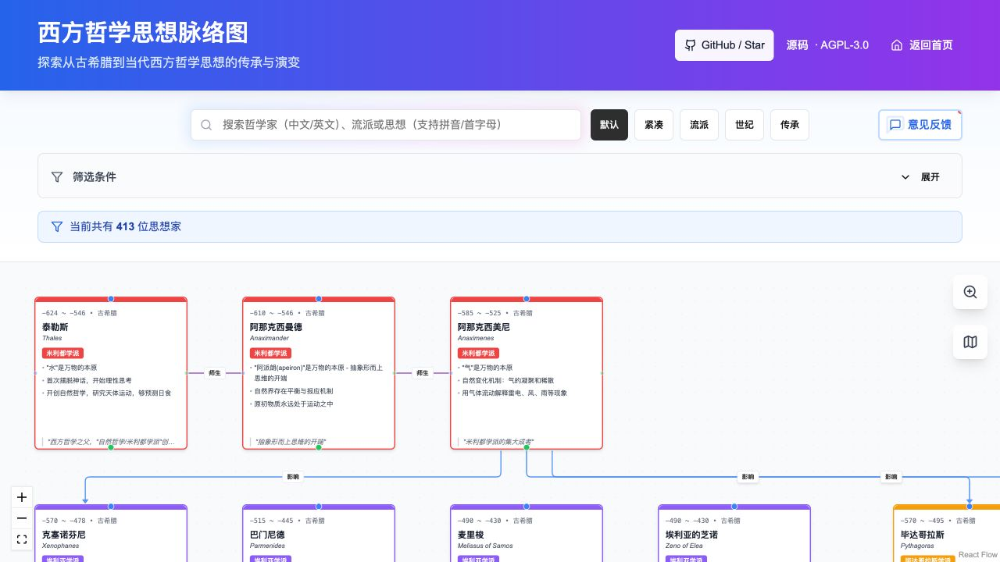
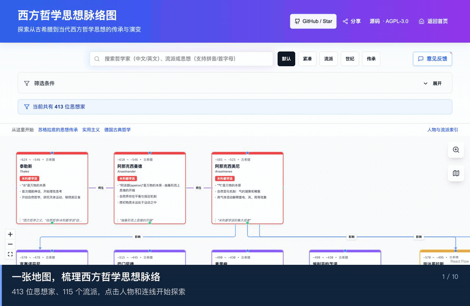

# 西方哲学思想脉络图 · 西方哲学史地图 | Western Philosophy Map

[](LICENSE)

**开源许可：本项目原创代码采用 [AGPL-3.0-only](LICENSE)（仅第 3 版），不采用 MIT 授权。** 修改后通过网络向用户提供服务时，须按许可向这些用户提供该版本的完整对应源码。

一个面向**西方哲学入门、哲学史学习与阅读梳理**的开源交互式知识图谱。通过一张可搜索、可筛选的思想地图，梳理西方哲学史脉络，探索西方哲学史发展中的哲学家、哲学流派与思想传承。

**当前公开快照：413 位哲学家 · 115 个流派 · 131 条关系 · 5 种布局 · 无需数据库**

**[在线体验：开源独立版（推荐）](https://western-philosophy.inklinks.io/)**

专注哲学图谱浏览，内容随开源版本更新；纠错和建议通过 [GitHub Issues](https://github.com/adonisly/western-philosophy-map/issues) 提交。

A Chinese-language, interactive **Western philosophy map** for exploring the **history of philosophy**, philosophical schools, philosopher influences and intellectual history. Follow a philosophy timeline by century or explore connections in a searchable knowledge graph. Runs with bundled JSON data; no database or API key required.

[](https://western-philosophy.inklinks.io/)

## 操作演示

<details>
<summary>查看操作动图：搜索、人物详情与布局切换</summary>



</details>

以上为实际运行页面的界面采集，展示图谱的局部视图。完整内容可在[在线版](https://western-philosophy.inklinks.io/)中搜索、拖动和缩放探索。

## 30 秒上手

1. 搜索「苏格拉底」或「sgld」，选择建议中的人物并定位卡片。
2. 点击卡片，阅读生平、主要思想、著作、思想继承与后世影响。
3. 切换「传承」「世纪」或「流派」布局，从不同线索梳理同一组人物。

如果这个工具对学习有帮助，欢迎点击页面右上角的 **GitHub / Star** 收藏源码；资料纠错请通过 [Issues](https://github.com/adonisly/western-philosophy-map/issues) 提交并附上来源。

## 分享与探索

- 点击标题栏的「分享」，复制当前布局、搜索与筛选；点击人物详情中的「分享此人物」，让对方直接定位人物并打开详情。链接保留当前站点的域名与路径，不保存拖动和缩放。
- 从「苏格拉底的思想传承」「实用主义」「德国古典哲学」三个入口开始探索。
- [人物与流派索引](https://western-philosophy.inklinks.io/explore/)无需 JavaScript 即可阅读，点击姓名进入对应图谱。
- 示例：[苏格拉底的思想传承](https://western-philosophy.inklinks.io/?layout=lineage&philosopher=socrates_1760717560724)、[实用主义流派](https://western-philosophy.inklinks.io/?layout=school&school=%E5%AE%9E%E7%94%A8%E4%B8%BB%E4%B9%89)。

## 在线版本与更多阅读资源

**[Readmap 主站版](https://readmap.inklinks.io/knowledge-graphs/western-philosophy)**

使用同一套图谱核心，内容随主站维护更新，并提供站内评论与反馈。Readmap（阅读路书）主站还提供：

- **[阅读路径](https://readmap.inklinks.io/reading-paths)**：按主题和学科查看系统化、分层次的阅读路线。
- **[更多知识图谱](https://readmap.inklinks.io/knowledge-graphs)**：继续探索[西方音乐史](https://readmap.inklinks.io/knowledge-graphs/western-music)、[佛教史](https://readmap.inklinks.io/knowledge-graphs/buddhism-history)、[荷马史诗](https://readmap.inklinks.io/knowledge-graphs/homeric-epic)和[中国历史朝代](https://readmap.inklinks.io/knowledge-graphs/chinese-dynasties)。
- **[阅读社区入口](https://bookclub.inklinks.io/)**：跳转到配套的外部阅读社区。
- **资源检索与课程入口**：[网盘搜索](https://readmap.inklinks.io/pan-search)聚合多来源资源检索，[课程资源](https://readmap.inklinks.io/resources)集中整理课程信息；这两个入口需访问口令。

两个版本的**哲学图谱核心浏览功能相同**，内容更新时间和反馈方式有所不同；需要探索更多主题和阅读资源时，可以从[阅读路书首页](https://readmap.inklinks.io/)继续。

## 用思想地图梳理西方哲学史

- **西方哲学史脉络图**：从古希腊到当代，结合人物、流派与有向关系，观察哲学思想的继承、发展与批判。
- **哲学家关系图**：查看苏格拉底、柏拉图、亚里士多德、康德、黑格尔等人物的联系，定位思想来源与后继影响。
- **哲学流派关系与谱系**：按流派、时代和层级筛选，在默认、紧凑、流派、世纪与传承五种布局之间切换。
- **西方哲学时间线**：使用世纪布局观察哲学家的年代分布，辅助梳理西方哲学发展史与哲学思想演变。
- **哲学史阅读辅助**：打开人物详情，查阅主要思想、著作、生平、思想继承与后世影响；支持中文、英文名、拼音和首字母搜索。

## 内容覆盖：哲学家、哲学流派与思想传承

图谱收录了西方哲学史及相关思想史中的人物与学派，具体内容以仓库内的数据快照为准。例如：

- **古希腊哲学**：苏格拉底、柏拉图、亚里士多德，以及斯多葛主义、伊壁鸠鲁主义和怀疑主义。
- **中世纪哲学**：奥古斯丁、托马斯·阿奎那，以及教父哲学和经院哲学。
- **近代西方哲学**：笛卡尔、斯宾诺莎、洛克、休谟、康德、黑格尔、马克思和尼采，涉及理性主义、经验主义和德国古典哲学等思想传统。
- **现代与当代哲学**：胡塞尔、海德格尔、罗素、维特根斯坦、萨特和福柯，涉及现象学、存在主义、分析哲学和后结构主义等流派。

**English subject areas:** ancient Greek philosophy, medieval philosophy, modern philosophy, contemporary philosophy, rationalism, empiricism, German idealism, phenomenology, existentialism and analytic philosophy.

## 学习与使用

### 如何梳理西方哲学史的发展脉络？

可以先按时代或流派筛选，再使用世纪布局观察年代分布，使用传承布局和关系高亮追踪哲学家的思想联系。人物详情提供进一步阅读时可参考的思想摘要和著作信息。

### 可以当作西方哲学史思维导图使用吗？

可以把它作为交互式哲学史思维导图和知识地图，辅助哲学入门、哲学史复习与阅读笔记整理。人物与关系是持续整理的学习材料，重要论断仍应结合原著与可靠研究核对；欢迎附来源提交纠错。

### 需要数据库或账号吗？

浏览在线图谱、在本地运行和部署静态版本均不需要数据库、账号或 API key。项目基于 React、TypeScript 和 React Flow，默认读取仓库自带的公开 JSON 数据。

## 本地运行

需要 Node.js 22.12 或更新版本。

```bash
npm ci
npm run dev
```

打开 `http://127.0.0.1:3100`。

```bash
npm test
npm run build
npm run preview
```

构建结果在 `dist/`，可部署到 GitHub Pages、Vercel 或其他静态网站托管服务。构建使用相对资源路径，也支持部署在子目录。

## 功能与数据

- 中文、英文、拼音和首字母搜索。
- 按流派、时代、层级筛选。
- 默认、紧凑、流派、世纪、传承五种布局。
- 人物详情、主要思想、著作、思想继承和后世影响。
- 有向关系、祖先和后继高亮、缩放与小地图。
- 搜索历史保存在当前浏览器的本地存储中。

`public/data/philosophy.json` 保存人物、流派（包括颜色和布局坐标）、关系、关系类型和推荐搜索词。`snapshot-info.json` 记录导出时间、记录数与 SHA-256；它是导出时的溯源信息，贡献者修改数据后由维护者在发布时刷新。

同一数据快照与同一版本核心使用相同的布局和渲染逻辑。静态版不会实时接收 Readmap 数据库更新，不提供主站的评论、全站搜索次数统计、登录和管理后台；反馈按钮链接到 GitHub Issues。不同浏览器、字体和视口也可能影响像素级显示。

## 贡献

欢迎通过 Issue 提出纠错或通过 Pull Request 贡献代码和资料。详见 [CONTRIBUTING.md](CONTRIBUTING.md)。人物资料与影响关系是持续整理的学习材料，提交资料时请给出可信来源；影响关系的方向与类型需要有依据。

想向同学或读书伙伴介绍这个项目？可参考[项目介绍与演示示例](docs/SHARING.md)，并直接使用仓库内的截图和动图。

## 网站搜索与分享配置

构建会从公开快照生成首页静态介绍、人物与流派索引、sitemap.xml 和 robots.txt，并加入 canonical、Open Graph 与 Twitter Card。它们改善内容读取与链接预览，不保证收录或排名。

自行部署到其他域名或子目录时，用实际公开地址构建：

```bash
VITE_SITE_URL=https://example.com/philosophy/ VITE_SOURCE_URL=https://github.com/your-name/your-repo/tree/your-commit npm run build
```

默认公开地址为本项目独立站。迁移域名时也需修改或移除 `public/CNAME`。分享封面为 [public/social-preview.png](public/social-preview.png)，可编辑源文件为 [assets/social-preview.svg](assets/social-preview.svg)；自建站请同步替换封面上的域名。GitHub 仓库的 Social preview 需在仓库 Settings 中单独上传，网站 Open Graph 不会代替该设置。

版本变更见 [CHANGELOG.md](CHANGELOG.md)，有来源的资料修订见 [docs/DATA-CORRECTIONS.md](docs/DATA-CORRECTIONS.md)。

## 复用图谱核心

`src/WesternPhilosophyMap.tsx` 是独立站与 Readmap 共用的实现。主站只注入 `PhilosophyDataSource`（读取与可选的新增订阅）、搜索统计回调、热词与反馈入口。`src/main.tsx` 是静态 JSON 适配入口。核心不依赖 Next.js、Supabase 或 Readmap 的服务端代码。

代码改进在本仓库合并，Readmap 由维护者更新到对应版本；公开 PR 不会直接写入生产数据库。数据贡献的审核与导入流程见贡献指南。

## 许可

项目原创代码采用 **GNU Affero General Public License v3.0（SPDX：`AGPL-3.0-only`，仅第 3 版）**，完整条款见 [LICENSE](LICENSE)。

- **允许使用、修改、分发和商用**，须遵守许可规定的版权、许可声明及适用的源码提供要求。
- **修改后通过网络向用户提供服务**，须按许可向这些用户显著提供免费获取该版本完整对应源码的入口。
- 可以 Fork 并按许可复用，不要求向本仓库提交 PR；贡献授权见 [CONTRIBUTING.md](CONTRIBUTING.md)。

独立站标题栏的“源码 · AGPL-3.0”入口提供部署版本的源码。自行修改并部署时，应将 `VITE_SOURCE_URL` 设置为实际部署版本的完整对应源码地址。GitHub Actions 工作流自动指向该仓库本次构建的提交；其他部署环境默认指向本项目的 `main`，部署者需要核对或覆盖该设置。

版权与第三方归属见 [NOTICE.md](NOTICE.md)。

**第三方许可说明：** 基础按钮、输入框及相关 UI 工具保留原有 MIT 许可；该声明仅适用于对应第三方组件，不代表整个项目采用 MIT。见 [third-party/shadcn-ui-LICENSE](third-party/shadcn-ui-LICENSE)。第三方依赖遵循各自许可证；图谱内书名、引文与引用资料的权利归原权利人，本项目许可不额外授予这些第三方内容的权利。请保留来源与署名信息。代码许可也不自动授予冒用项目名称、标识或官方身份的权利。
